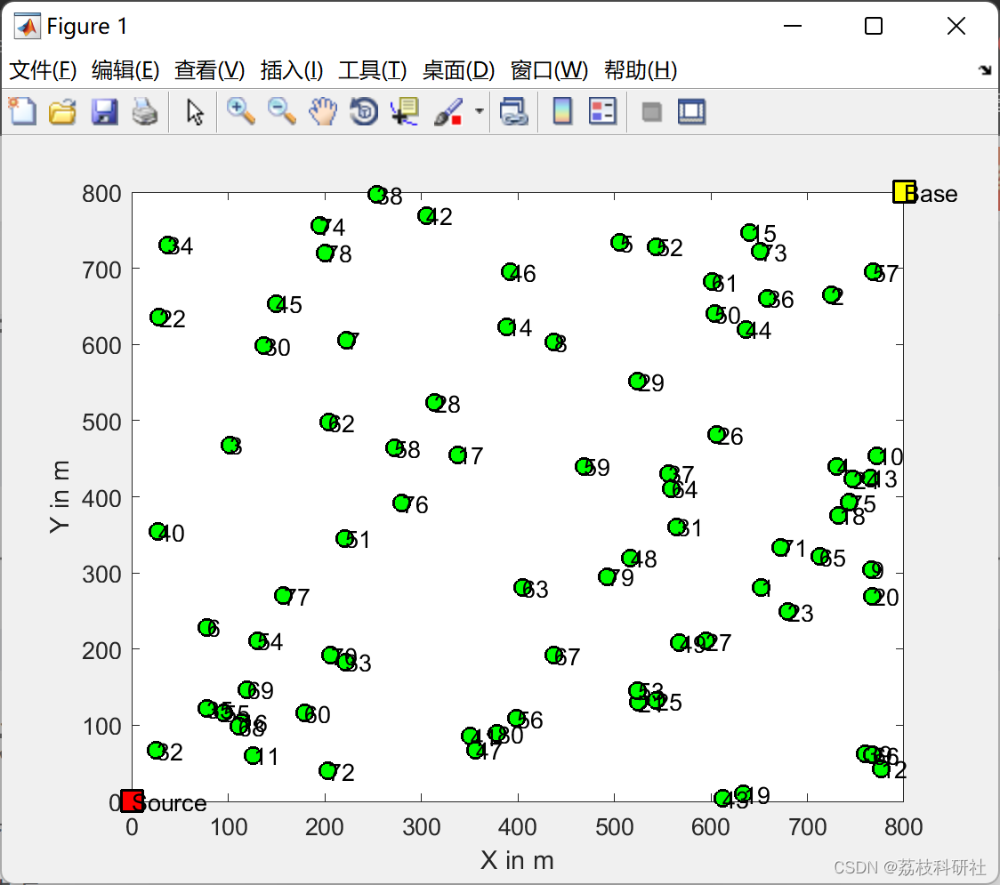
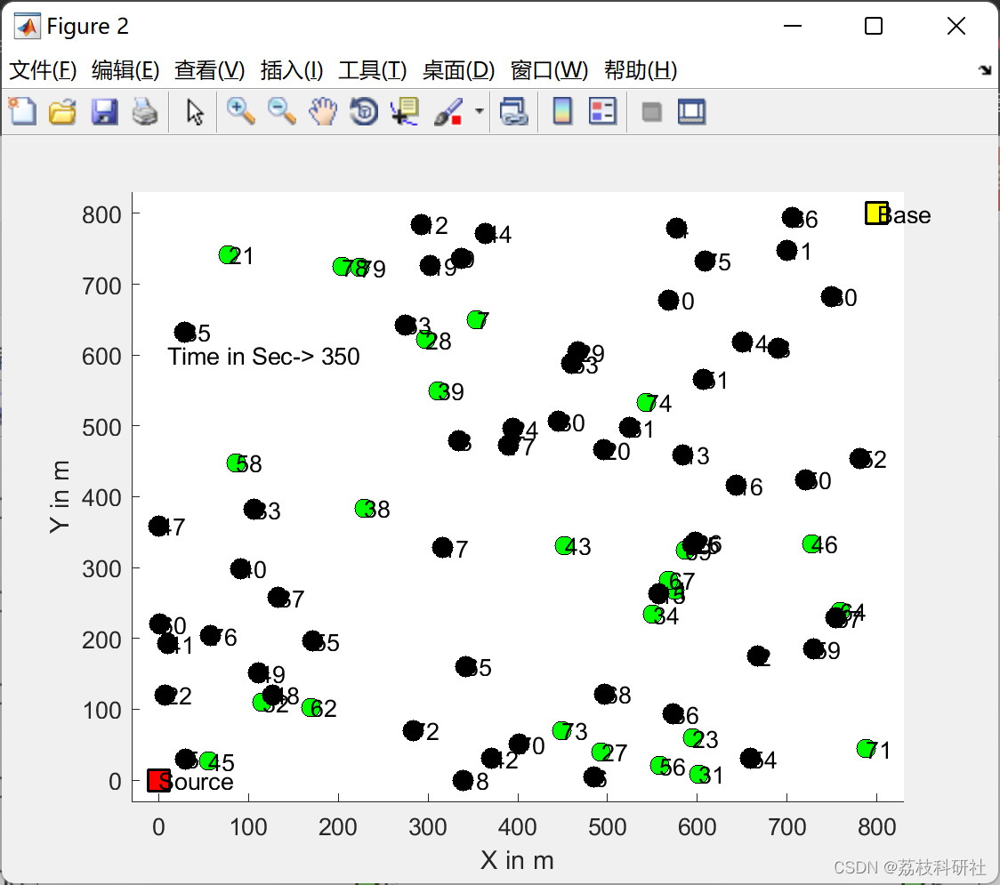
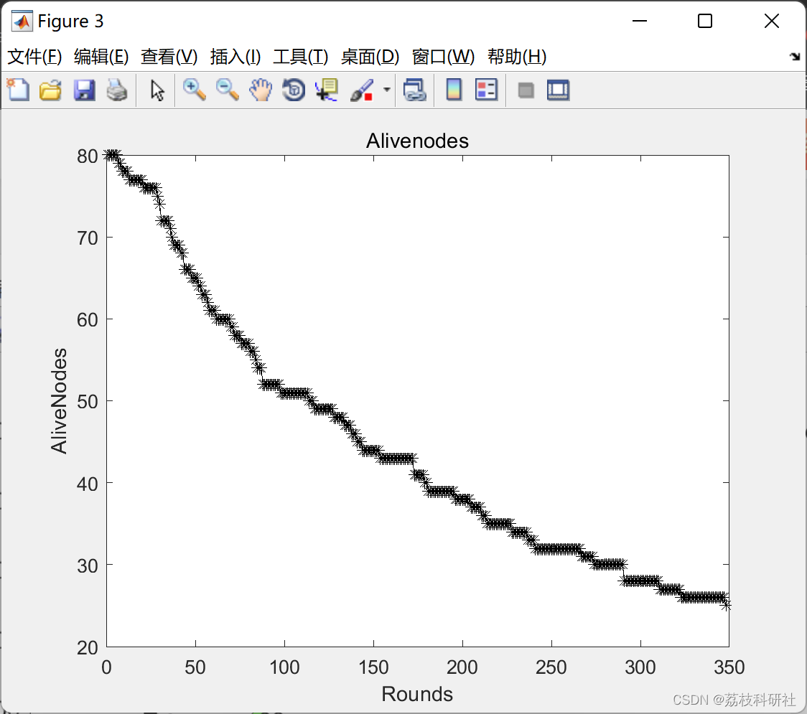
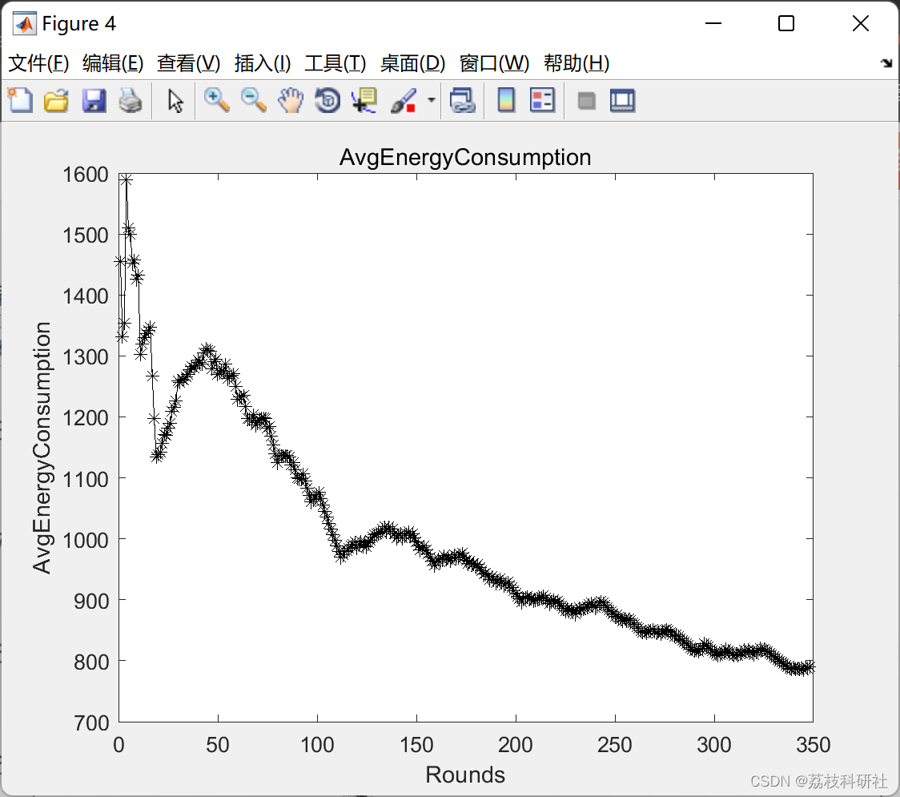
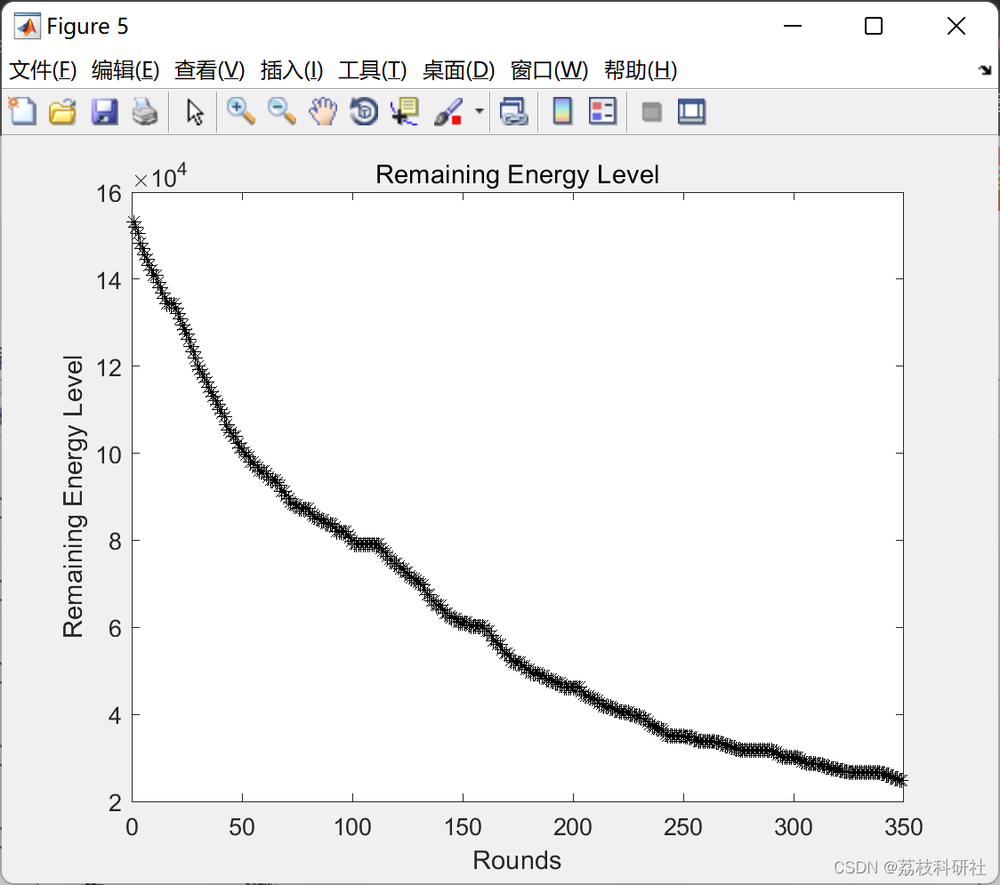
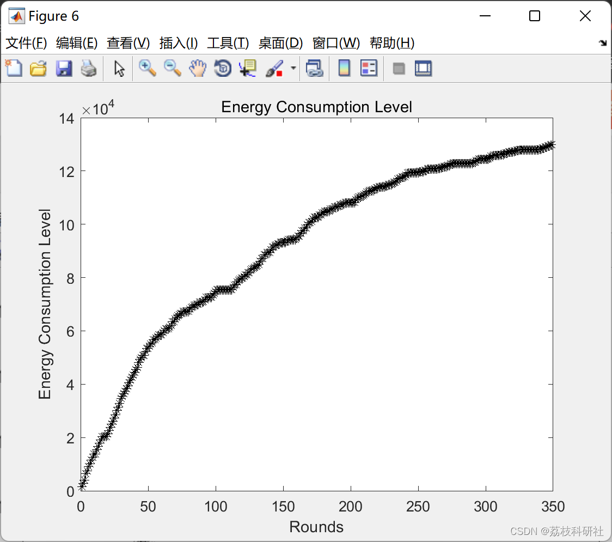
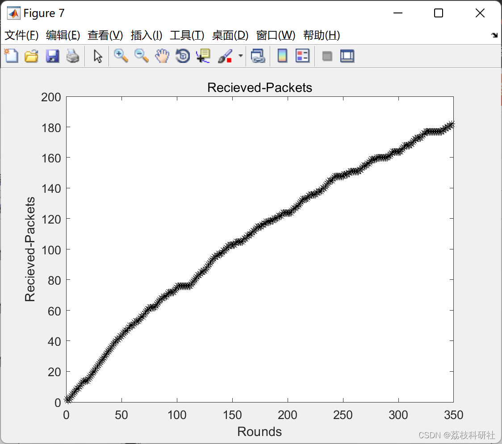

# Data Communication: Random Waypoint Movement with Routing WSN Simulator (Matlab Code Implementation)

2. Implementing the basic RWM in the middle node
3. Applying the RWM in the middle node
4. Evaluating the results
📚2 Editing the run results
​Editing
​Editing
​Editing
​Editing
​Editing
​Editing
Part of the code:
function [r_path, r_cost] = DjisktraRoute(pathS, pathE, transmat)  
noOfNode = size(transmat, 1);  
for i = 1:noOfNode  
parent(i) = 0;  
distance(i) = inf;  
end  
queue = [];  
% Start from pathS  
for i=1:noOfNode  
if transmat(pathS, i)~=inf  
distance(i) = transmat(pathS, i);  
parent(i) = pathS;  
queue   = [queue i];  
end  
end  
% Width-first exploring the whole graph  
while length(queue) ~= 0  
hopS = queue(1);  
queue = queue(2:end);  
for hopE = 1:noOfNode  
if distance(hopE) > (distance(hopS) + transmat(hopS,hopE))  
distance(hopE) = distance(hopS) + transmat(hopS,hopE);
parent(hopE) = hopS;  
queue     = [queue hopE];  
end  
end  
end  
distance ;  
parent ;  
% Back-trace the shortest-path  
r_path = [pathE];  
i = parent(pathE);  
while i~=pathS && i~=0  
r_path = [i r_path];  
i   = parent(i) ;  
end  
if i==pathS  
r_path = [i r_path];  
else  
r_path = [];  
end  
% Return cost  
r_cost = distance(pathE);  
🎉3 References
🌈4 Matlab code implementation

## Images

<!-- PAYMENT_BLOCK -->

## Get this dataset

- Payment link (Stripe): [Buy now](https://buy.stripe.com/3cs8yP7sY87d0vu9AB)
- Payment QR code: 

<!-- /PAYMENT_BLOCK -->
